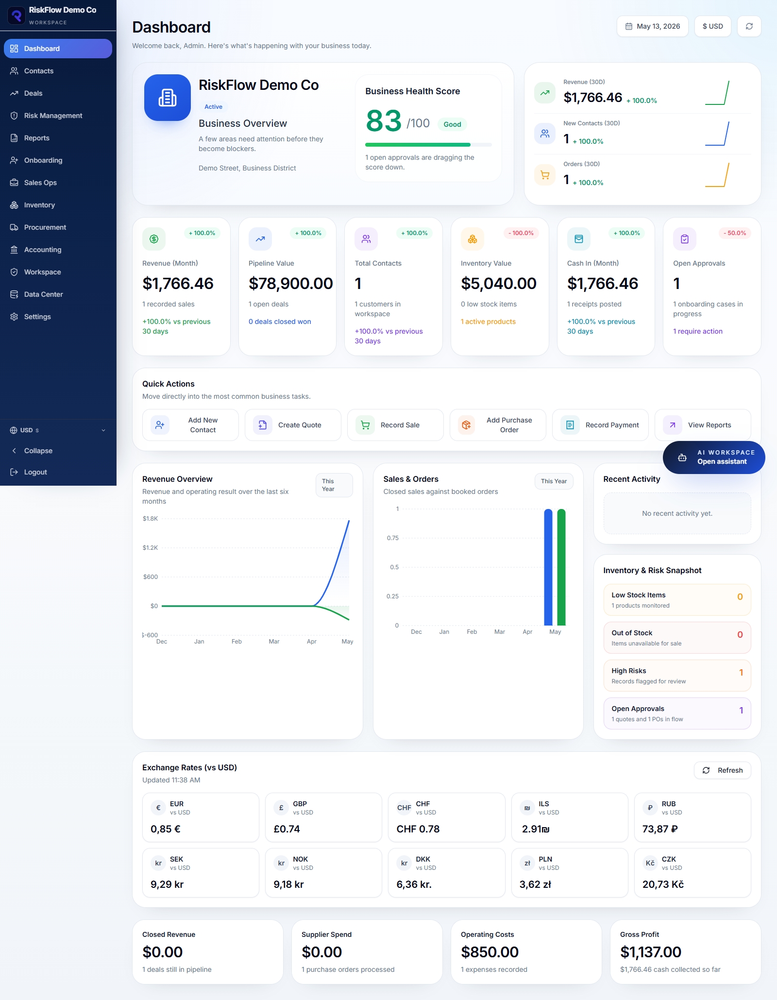
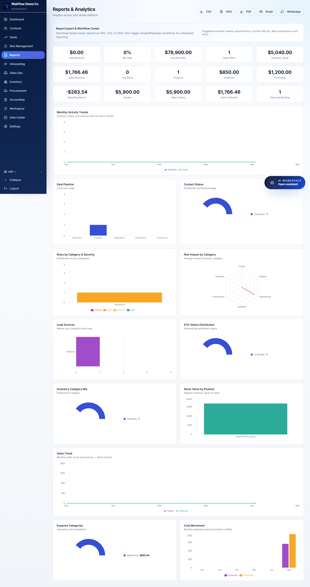
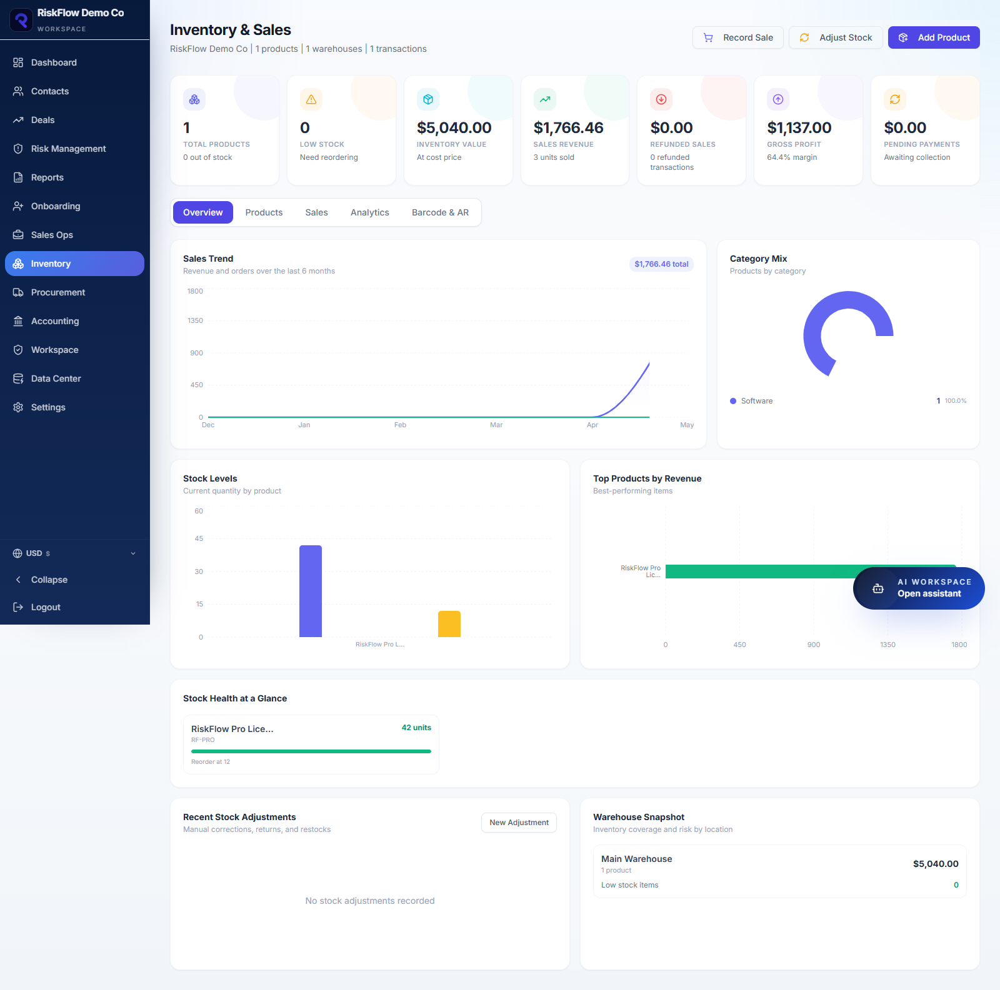
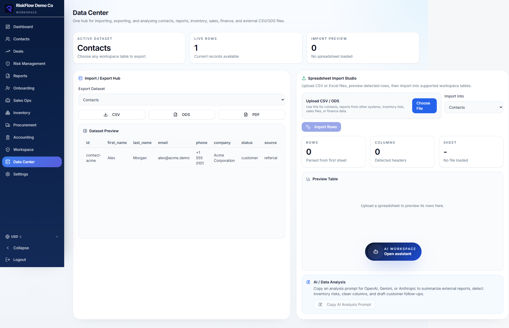
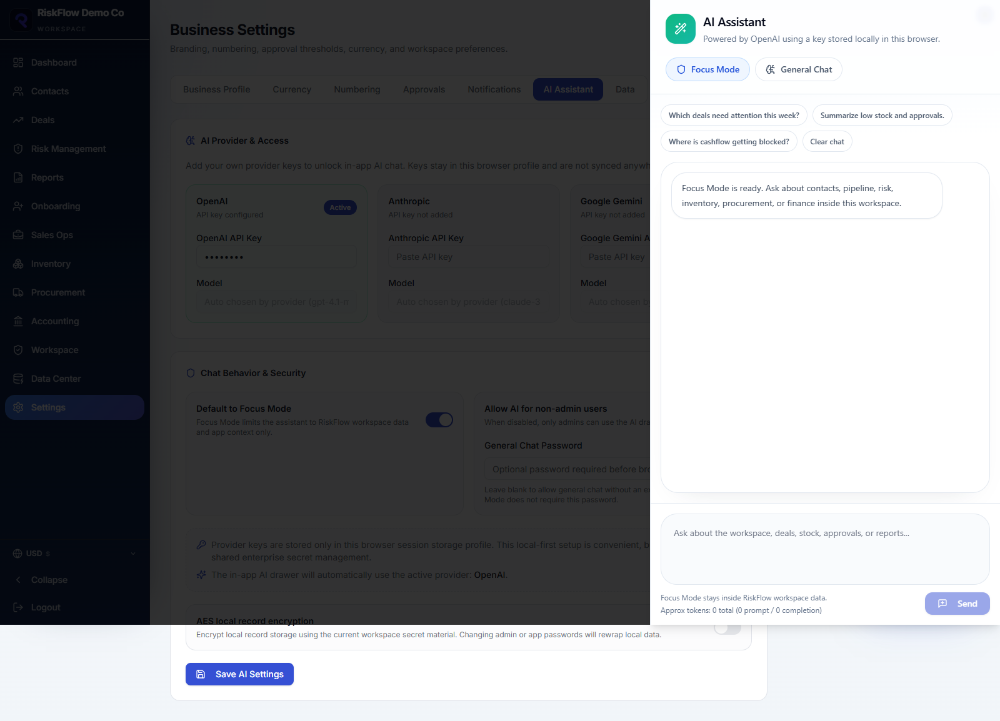

# RiskFlow CRM

RiskFlow CRM is a local-first business management workspace for CRM, sales, inventory, procurement, accounting, reporting, data import/export, branded documents, and optional AI assistance.

## Run

Requires Node.js 20 or newer. From the project root run `npm install`, then `npm run dev -- --host 127.0.0.1 --port 5173 --strictPort` and open http://127.0.0.1:5173. On Windows you can instead run `scripts\start-riskflow.ps1`. See `HOW TO RUN.md` for details.

## Features

- Reports export as PDF, CSV, ODS, and workflow messages for email or WhatsApp.
- Invoices export as branded PDFs with email and WhatsApp follow-up workflows.
- Data Center is the import, export, and analysis hub for contacts, reports, inventory, sales, finance, and external CSV/ODS files.
- AI Assistant supports OpenAI, Gemini, and Anthropic with provider-managed model defaults.
- Inventory supports barcode lookup fields and AR/3D reference metadata.

## Screenshots

The GitHub screenshot pack is in `github/screenshots`.







## Development

```bash
npm install
npm run dev
```

## Build

```bash
npm run build
```

## Storage

The app stores workspace data in the browser for the local URL it is opened on. Always use `http://127.0.0.1:5173`, so data stays on one browser origin.

## License

Copyright (C) 2026 Kivitas

This project is licensed under the GNU Affero General Public License v3.0 only (AGPLv3). See `LICENSE`.
